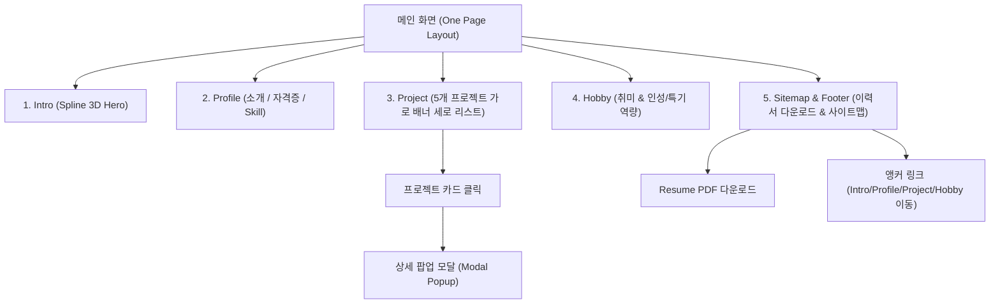

# [PRD] 유치원 교사 포트폴리오 웹사이트 구축 요구사항 명세서
**Product Requirements Document: Interactive Resume & Portfolio for Kindergarten Teacher**

---

## 1. 문서 개요 (Overview)

### 1.1 프로젝트 개요
* **프로젝트명**: 이수경 유치원 교사 취업 포트폴리오 웹사이트
* **지원 직무**: 유치원 교사 / 보육교사
* **기술 스택**: React, Vite, Tailwind CSS (권장) 또는 Styled-Components, Spline 3D Viewer
* **주요 특징**:
  * 이미지 시안(SeaSats)의 모던하고 정돈된 그리드 레이아웃과 감성적인 무드를 접목
  * 3D Spline 인터랙티브 요소(안내 로봇 캐릭터)를 활용한 차별화된 첫인상 제공
  * 유치원/어린이집 채용 인사담당자(원장, 주임교사 등)가 지원자의 자격과 실무 역량을 30초 내에 직관적으로 파악할 수 있는 사용자 경험(UX) 제공

### 1.2 목표 및 성공 지표
| 구분 | 내용 |
| :--- | :--- |
| **핵심 목적** | 보육교사 1급 및 원장 자격증을 보유한 전문성과 실제 유아 교육 활동 역량을 한눈에 전달하여 면접 합격률 극대화 |
| **타겟 사용자** | 유치원·어린이집 채용 담당자, 원장 및 이사장, 동료 교사진 |
| **성공 지표 (KPI)** | - 메인 페이지 체류 시간 1분 30초 이상<br>- 프로젝트 상세 팝업 오픈율 60% 이상<br>- 하단 이력서(PDF) 다운로드 클릭율 30% 이상 |

---

## 2. 정보 구조도 (IA: Information Architecture) & 내비게이션

웹페이지는 단일 페이지(Single Page Application) 스크롤 형태로 구성되며, 상단 내비게이션 또는 플로팅 메뉴 및 하단 사이트맵을 통해 섹션 간 즉각적인 이동이 가능합니다.



---

## 3. 디자인 시스템 및 톤앤매너 (Design System & Mood)

시안(SeaSats)의 세련된 분할 그리드와 톤온톤 배색을 벤치마킹하되, **유아 교육 환경의 따뜻함과 원장 자격 보유자의 전문성·신뢰감**을 결합한 스타일을 적용합니다.

| 디자인 요소 | 명세 및 가이드라인 |
| :--- | :--- |
| **색상 팔레트** | - **Primary**: 웜 세이지 그린 (`#4A6B5B`) & 딥 포레스트 (`#1F3A2E`) - 전문성과 안정감<br>- **Secondary**: 부드러운 살구/베이지 톤 (`#FBF7F0`, `#F5ECE1`) - 따뜻하고 포근한 인상<br>- **Accent**: 산뜻한 테라코타/오렌지 (`#E07A5F`) - 활동성과 열정<br>- **Text & Neutral**: 다크 차콜 (`#222222`), 쿨 그레이 (`#6B7280`), 스켈레톤 백그라운드 (`#E5E7EB`) |
| **타이포그래피** | - **제목/강조**: Pretendard, Montserrat (신뢰감 있는 볼드 고딕)<br>- **본문/설명**: Pretendard, Noto Sans KR (가독성 높은 본문 서체) |
| **레이아웃** | - 12컬럼 반응형 그리드 시스템 (최대 너비 1280px)<br>- 넓은 상하 여백(Padding)을 두어 인사 담당자가 피로감 없이 편안하게 탐색할 수 있도록 구성 |

---

## 4. 섹션별 기능 및 UI/UX 상세 요구사항

### 4.1 Intro (히어로 섹션)
* **목적**: 3D 로봇 인터랙션을 통해 시선을 사로잡고 지원자의 이름을 각인시킴.
* **디자인 반영**: 시안 상단의 검색창/텍스트 input 요소는 완전히 제거하고 비주얼 중심의 히어로 영역 구축.
* **주요 구성 요소**:
  1. **Spline 3D iframe 배경/비주얼**:
     * URL: `https://my.spline.design/genkubgreetingrobot-CNSvvtA3TEkOLF28w8pjOKnX/`
     * 설정: `width='100%'`, `height='100%'`, `frameborder='0'`
     * 화면 높이 100vh(또는 최소 650px)를 차지하며 마우스 오버/드래그 시 3D 반응형 인터랙션 동작.
  2. **중앙 타이틀 오버레이**:
     * 텍스트: **‘이수경의 포트폴리오’** (중앙에 선명하고 세련된 타이포그래피로 배치)
     * 서브 카피: "아이들의 꿈과 함께 성장하는 교사, 이수경입니다."
  3. **스크롤 유도 인터랙션**: 하단 마우스 스크롤 인디케이터 (Lottie 애니메이션 또는 CSS 마우스 아이콘).

---

### 4.2 Profile (프로필 섹션)
* **목적**: 지원자의 기본 정보, 보유 자격증, 다룰 수 있는 오피스 스킬을 직관적인 인포그래픽 카드로 요약.
* **인적 사항**:
  * 성명: **이수경**
  * 생년월일: **1997년 3월 28일**
  * 지원 분야: **유치원 교사 / 보육교사**
* **하위 구성**:
  1. **내 소개 (About Me)**:
     * 원훈/교육 철학: "따뜻한 눈높이 소통과 체계적인 학급 운영으로 아이들에게 안전하고 행복한 일상을 선물합니다."
     * 교사로서의 3대 핵심 가치 (예: 공감과 경청, 창의적 놀이 지도, 신뢰받는 학부모 소통).
  2. **자격증 (Certifications)**:
     * **보육교사 1급 자격증** (보건복지부)
     * **어린이집 원장 자격증** (원장 사전 직무교육 이수 및 자격 취득)
     * *뱃지 및 인증서 카드 형태로 시각화하여 원장급의 책임감과 전문성을 강조.*
  3. **보유 기술 (Skills)**:
     * **파워포인트 (PPT)**: 입학설명회 자료 제작, 부모 참여 수업 프레젠테이션, 멀티미디어 교육 자료 구성 능력 (숙련도 상)
     * **한글 (HWP)**: 주간/월간 교육계획안, 관찰일지, 운영일지, 공문서 및 가정통신문 신속·정확한 작성 능력 (숙련도 최상)
     * *막대 그래프 또는 게이지 바 + 실무 활용 사례 툴팁 제공.*

---

### 4.3 Project (프로젝트 섹션)
* **목적**: 5개 대표 프로젝트를 통해 수업 설계, 학급 경영, 놀이 프로그램 기획 역량을 실증.
* **레이아웃 구조**:
  * **가로형 배너 카드가 세로로 5개 나열**되는 리스트형 구조.
  * 각 카드 내부 레이아웃:
    * **좌측 (40~45%)**: 프로젝트 미리보기 이미지 영역 (Placeholder).
      * 실사 이미지를 임의로 생성하지 않고 그레이 톤 플레이스홀더로 렌더링.
      * 이미지 위에 **대체할 파일명 오버레이 표기** (예: `[이미지 경로: /images/projects/project-01.jpg]`).
    * **우측 (55~60%)**: 프로젝트 메타 정보 (기간, 역할, 카테고리 태그, 핵심 개요, 주요 성과).
* **스켈레톤 UI (Skeleton UI)**:
  * 데이터 패칭 및 컴포넌트 마운트 시, 텍스트와 이미지 형태를 본뜬 펄스(Pulse) 애니메이션 스켈레톤 카드를 먼저 렌더링하여 체감 로딩 속도 향상.
* **동적 렌더링 (Dynamic Rendering)**:
  * 프로젝트 데이터를 별도의 JSON 파일(`src/data/projects.json`)로 분리.
  * 데이터 개수가 5개에서 3개 또는 7개로 변경되어도 화면 레이아웃이 유연하게 확장/축소되도록 `map()` 렌더링 설계.
* **클릭 시 모달 팝업 (Detail Modal)**:
  * 가로 배너 클릭 시 배경 블러 처리와 함께 중앙 모달 팝업 오픈.
  * 팝업 내용: 상세 추진 배경, 누리과정 연계 영역, 활동 사진(Placeholder), 유아 반응 및 학습 성과, 교사 회고.
* **임의 프로젝트 5종 기획안**:
  1. `project-01`: 사계절 생태 놀이 중심 교육과정 기획 및 운영
  2. `project-02`: 그림책 기반 감정 코칭 및 언어 발달 놀이 프로그램
  3. `project-03`: 가정 연계 부모 참여 열린 어린이집 프로그램 (PPT 활용)
  4. `project-04`: 스마트 안전 교육 및 원내 재난 대응 시뮬레이션 매뉴얼
  5. `project-05`: 연령별 누리과정 관찰일지 및 발달 평가 표준 서식 체계화 (한글 활용)

---

### 4.4 Hobby (취미 섹션)
* **목적**: 교사의 인성, 스트레스 해소 방식, 교구 제작 등 유아 지도와 연계될 수 있는 개인적 특기 제시.
* **컨텐츠 기획**:
  * **취미 1. 펠트 & 친환경 DIY 교구 만들기**: 손재주와 꼼꼼함을 통해 맞춤형 놀이 교구 직접 제작.
  * **취미 2. 동화 구연 및 아동 문학 감상**: 실감 나는 음성과 제스처로 아이들의 몰입을 이끄는 스토리텔링 역량.
  * **취미 3. 실내 반려식물 가꾸기(가드닝)**: 자연 생태 놀이 교육과 연계되는 생명 존중 태도 및 인내심.
* **UI 표현**: 3열 카드 그리드 또는 슬라이더 형태로 감성적인 아이콘과 짧은 스토리텔링 텍스트 배치.

---

### 4.5 Sitemap & Footer (하단 섹션)
* **구성 요소**:
  1. **Resume PDF 다운로드 액션 바**:
     * 강조된 버튼: `[ 이수경 교사 이력서 & 경력기술서 PDF 다운로드 📥 ]`
     * 파일 링크: `public/assets/resume_leesoogyeong.pdf`
     * 다운로드 클릭 시 새 탭 열기 또는 즉시 다운로드(`download` 속성) 지원.
  2. **사이트맵 링크 (Quick Navigation)**:
     * `Intro` (홈/첫 화면)
     * `Profile` (교사 소개, 자격증, 보유 스킬)
     * `Project` (교육 프로젝트 5선)
     * `Hobby` (취미 및 교사 특기)
     * 클릭 시 부드러운 스크롤(`smooth scroll`)로 해당 섹션으로 뷰포트 이동.
  3. **연락처 및 카피라이트 정보**:
     * 이메일, 전화번호(비공개/안심번호 포맷), 근무 가능 지역 표기.
     * Copyright © 2026 Lee Soo Gyeong. All rights reserved.

---

## 5. 데이터 스키마 및 파일 구조 설계

### 5.1 프로젝트 데이터 구조 (`src/data/projects.json`)
```json
[
  {
    "id": 1,
    "title": "사계절 생태 놀이 중심 교육과정 운영",
    "category": "누리과정 / 생태체험",
    "period": "2025.03 ~ 2025.11",
    "thumbnail": "/images/projects/project-01.jpg",
    "thumbnailPlaceholder": "project-01.jpg",
    "summary": "원내 텃밭과 숲 놀이터를 활용하여 사계절의 변화를 온몸으로 느끼는 오감 생태 프로그램 기획 및 실행",
    "tags": ["생태교육", "오감체험", "연간계획"],
    "details": {
      "objective": "자연 친화적 태도 함양 및 신체·정서 발달 촉진",
      "myRole": "연간 교육계획안 수립, 텃밭 가꾸기 주도, 활동 사진집 제작",
      "skillsUsed": ["한글 (교육계획안)", "파워포인트 (결과보고서)"],
      "outcomes": "유아 관찰 평가 호기도 95% 달성, 학부모 만족도 98% 기록",
      "images": [
        "/images/projects/project-01-detail-1.jpg",
        "/images/projects/project-01-detail-2.jpg"
      ]
    }
  }
]
```

### 5.2 폴더 디렉터리 구조 (Vite + React)
사용자가 추후 이미지를 쉽게 업로드하고 교체할 수 있도록 직관적인 폴더 규칙을 설정합니다.

```text
portfolio-leesoogyeong/
├── public/
│   ├── images/
│   │   ├── profile/            # 프로필 증명사진 및 전신 사진 (profile.jpg)
│   │   └── projects/           # [중요] 사용자가 실제 이미지로 대체할 폴더
│   │       ├── project-01.jpg  # 1번 프로젝트 썸네일
│   │       ├── project-02.jpg  # 2번 프로젝트 썸네일
│   │       ├── project-03.jpg  # 3번 프로젝트 썸네일
│   │       ├── project-04.jpg  # 4번 프로젝트 썸네일
│   │       └── project-05.jpg  # 5번 프로젝트 썸네일
│   └── assets/
│       └── resume_leesoogyeong.pdf # 이력서 다운로드 파일
├── src/
│   ├── components/
│   │   ├── common/
│   │   │   ├── Header.jsx
│   │   │   ├── Modal.jsx
│   │   │   └── SkeletonCard.jsx # 스켈레톤 로딩 컴포넌트
│   │   ├── intro/
│   │   │   └── SplineIntro.jsx  # Spline 3D iframe 및 타이틀
│   │   ├── profile/
│   │   │   ├── ProfileSection.jsx
│   │   │   ├── Certifications.jsx
│   │   │   └── SkillBar.jsx
│   │   ├── project/
│   │   │   ├── ProjectList.jsx  # 세로 배너 리스트 컨테이너
│   │   │   ├── ProjectCard.jsx  # 가로형 배너 카드 (Placeholder 포함)
│   │   │   └── ProjectModal.jsx # 상세 팝업 모달
│   │   ├── hobby/
│   │   │   └── HobbySection.jsx
│   │   └── sitemap/
│   │       └── SitemapFooter.jsx# PDF 다운로드 및 사이트맵
│   ├── data/
│   │   └── projects.json        # 동적 프로젝트 데이터셋
│   ├── styles/
│   │   └── index.css
│   ├── App.jsx
│   └── main.jsx
├── index.html
├── package.json
└── vite.config.js
```

---

## 6. 비기능적 요구사항 (Non-Functional Requirements)

1. **Spline 3D iFrame 최적화**:
   * 모바일/저사양 기기 환경에서 버벅임이 발생하지 않도록 `loading="lazy"` 적용 및 백그라운드 폴백 컬러 지정.
   * iframe 내부 클릭/스크롤 이벤트가 메인 페이지 스크롤 동작을 방해하지 않도록 CSS `pointer-events` 속성을 적절히 제어.
2. **반응형 웹 디자인 (Responsive Web Design)**:
   * **Desktop (1024px 이상)**: 시안 그대로 가로 배너 형태 (좌측 이미지 + 우측 텍스트 2단 분할).
   * **Mobile / Tablet (1023px 이하)**: 가로 배너가 세로형 카드(상단 이미지 + 하단 텍스트)로 자연스럽게 스택 변경.
3. **접근성 및 SEO**:
   * 이미지 Placeholder 및 실제 이미지 교체 시 `alt` 속성에 프로젝트명 및 상세 설명 필수 명시.
   * 유치원 인사 담당자가 출력(Print)할 때 레이아웃이 깨지지 않도록 미디어 쿼리(`@media print`) 고려.
4. **이미지 교체 편의성**:
   * 이미지가 누락되거나 아직 업로드되지 않은 경우 깨진 이미지 아이콘 대신 깔끔한 SVG 플레이스홀더와 파일명 태그가 노출되도록 `onError` 핸들러 구축.

---

## 7. 개발 로드맵 및 태스크 체크리스트

| 단계 | 태스크 내용 | 산출물 / 완료 기준 |
| :---: | :--- | :--- |
| **Step 1** | Vite 기반 React 프로젝트 환경 설정 및 Tailwind CSS 세팅 | 기본 템플릿 구동 확인 |
| **Step 2** | `public/images/projects/` 디렉터리 생성 및 Placeholder 컴포넌트 개발 | 파일명 오버레이 UI 구현 |
| **Step 3** | Spline 3D iframe 임베딩 및 Intro 섹션 완성 | 3D 로봇 애니메이션 정상 동작 |
| **Step 4** | Profile 섹션 구현 (소개, 보육교사 1급/원장 자격증 뱃지, PPT/한글 스킬바) | 인포그래픽 UI 완성 |
| **Step 5** | Project 섹션 구현 (스켈레톤 UI, 가로 배너 리스트, 모달 팝업, 동적 렌더링) | 5개 프로젝트 데이터 바인딩 |
| **Step 6** | Hobby 및 Sitemap/Footer 구현 (PDF 다운로드 트리거, 앵커 스크롤) | 전체 링크 연결 검증 |
| **Step 7** | 반응형 모바일 최적화 및 크로스 브라우징 테스트 | 최종 배포 준비 완료 |
